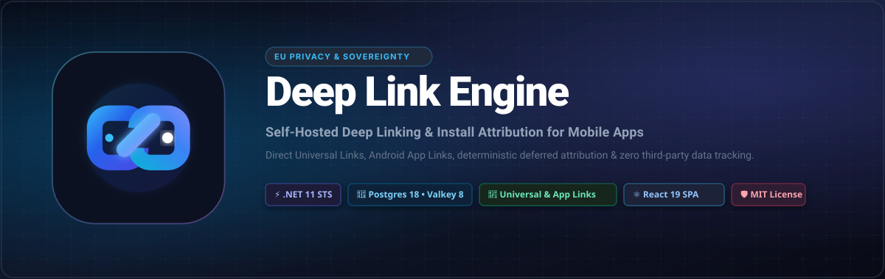

<p align="center">
  
</p>

# Deep Link Engine

**Self-hosted, EU-first deep linking and install attribution for mobile apps.** Branded short links that
open the right screen in your app, deferred deep linking through the app-store install, and attribution
that tells you honestly how sure it is. One compose stack, your PostgreSQL, your data.

> **Status: pre-release.** Nothing is tagged, no image or SDK is published. The .NET services, the web
> SDK, the admin console and both mobile SDKs build and pass their tests in CI; the integration suite
> runs against PostgreSQL 18 and Valkey 8. What has **not** happened yet: a run on real phones, a load
> test, an external penetration test and an install by someone who did not write it. Read
> [Where this stands](#where-this-stands) before relying on any of it.

## Why this exists

Firebase Dynamic Links was shut down on 25 August 2025. Google's suggested replacements are mostly
commercial mobile measurement partners: hosted by the vendor, priced by volume, and with an attribution
model that rests largely on probabilistic device fingerprinting — a mechanism the EDPB
Guidelines 2/2023 place under the consent requirement of ePrivacy Article 5(3). For a European company
with an app, a compliance officer and a finance director, that combination is a problem.

This engine is the alternative for that company: it runs inside your own infrastructure, so you are the
data controller and no third party sees a click; it does deterministic attribution first and treats
probabilistic matching as an opt-in module that is off by default; and every attribution it records
carries a `match_type` and a `confidence`, because a probabilistic match presented as a certainty is the
industry's habit, not a law of nature.

It is not an attempt at feature parity with Branch or AppsFlyer. The wedge is self-hosting, EU compliance and attribution you can audit.

## What it does

| Layer | What you get |
|---|---|
| **Link resolution** | Branded domains, 8-character generated slugs or custom ones, routing rules by platform / OS and app version / country / language / in-app browser / time window / A/B split, Open Graph previews for verified crawlers, QR codes, an interstitial with a real tap target for in-app browsers. Never a `301`. |
| **Platform integration** | `apple-app-site-association` and `assetlinks.json` generated per domain and never redirected; a verifier that catches redirects on `/.well-known` and association files that do not match the registered apps. |
| **Direct open** | An installed app opened by a short link asks `POST /v1/resolve-link` (iOS `Dle.shared.resolveLink(url)`, Android `Dle.resolveLink(open)`) and gets the screen (`deeplink_path`) after the link's rules — `match_type` `direct_open`, confidence 1.0. |
| **Deferred deep linking** | Android: deterministic through the Play Install Referrer. iOS: a one-time claim code on the interstitial that the user types into the app. Both link an install to a click, so both need the tenant's `full` consent mode and recorded consent; under the default `aggregate_only` they answer `consent_missing`. Login reconciliation: a signed-in web visit records a hint through `POST /v1/login-hints` (web SDK `recordLoginHint`, consent-gated the same way), and the app's later resolve with the same account key matches it as `login`. |
| **Attribution** | `match_type` ∈ `install_referrer` · `login` · `claim_code` · `direct_open` · `probabilistic` · `none`, each with a confidence. Probabilistic is opt-in, consent-gated, and windowed to 60 minutes, not 7 days. |
| **Analytics** | Partitioned click stream in PostgreSQL, rollups, a dashboard that reports the deterministic / probabilistic / unmatched split. A ClickHouse sink is experimental and not wired end to end. |
| **Privacy** | Three consent modes per tenant (`off`, `aggregate_only`, `full`); IP hashed with a daily-rotated salt or not stored at all; no third-party call on the resolve path, including GeoIP. |
| **Operations** | Signed webhooks (HMAC-SHA256 + Ed25519), rate limits with a separate budget for 404s so scanners cannot enumerate slugs, DSA Art. 16 abuse reporting with quarantine (`410`) rather than deletion, audit log, OIDC single sign-on for the console. |

## Quick start

Requirements: Docker with Compose, and a domain you can point at the box.

```bash
git clone https://github.com/MAGORS-organisation/Deep-Links-Engine.git
cd Deep-Links-Engine/deploy
./setup-dev.sh            # Windows: .\setup-dev.ps1 — writes .env with generated secrets and the first owner key
# for a public domain, set DLE_DOMAIN and DLE_TLS (your ACME e-mail) in .env now
docker compose -f docker-compose.yml up -d --build
grep '^DLE_BOOTSTRAP_INITIAL_API_KEY=' .env    # the first owner key
# Windows: Select-String -Path .env -Pattern '^DLE_BOOTSTRAP_INITIAL_API_KEY='
```

On an empty database the control plane provisions a tenant with the owner API key from
`DLE_BOOTSTRAP_INITIAL_API_KEY` in `.env`; the key is never printed or logged. Sign in to the admin
console at `https://<your domain>/admin/` with it, create a named owner key, and revoke the bootstrap one.

Name the compose file explicitly: a plain `docker compose up` also loads `docker-compose.override.yml`,
the development profile (Caddy's internal CA, published ports, plain HTTP). No images are published yet,
so `--build` builds them from source. The first-30-minutes walkthrough is
[docs/self-hosting/quickstart.md](docs/self-hosting/quickstart.md).

For Kubernetes there is a Helm chart under [deploy/helm/dle](deploy/helm/dle) with an HPA for the edge
tier and a NetworkPolicy that enforces the no-egress rule.

## How it is built

Two deployment units from one solution, one database (ADR-010):

```
                ┌──────────────┐   GET /{slug}, /.well-known/*          ┌────────────┐
  users, bots ─▶│    Caddy     │───────────────────────────────────────▶│  dle-edge  │──▶ Valkey (L2 cache)
                │  TLS, HTTP/3 │   /api/*, /v1/*, /admin/*               │  :8080     │──▶ PostgreSQL (one query)
                └──────┬───────┘───────────────────────────────────────▶└─────┬──────┘
                       │                                                      │ async batch (COPY)
  SDKs ────────────────┘                                                      ▼
                                                                        ┌────────────┐
                                                                        │ dle-control│──▶ PostgreSQL (EF Core)
                                                                        │  :8081     │──▶ webhooks, workers
                                                                        └────────────┘
```

- **Edge** is the hot path: a Dapper query behind a stampede-safe two-level cache, client
  classification, rule evaluation, a 302 or an interstitial page. Telemetry goes into a bounded channel
  that drops under load rather than delaying the redirect.
- **Control** is EF Core: links, domains, apps, keys, the SDK endpoints, analytics, webhooks, abuse, and
  six leader-elected background workers.
- **Secrets are split.** The internet-facing edge never holds the control plane's master secret; it gets
  its own `DLE_EDGE_SECRET` and derives only the click-identifier, IP-hash and claim-code keys from it.
  A compromised edge cannot forge webhooks or tokens.
- **Crypto agility.** The webhook signature carries a key id and reserves a slot for a post-quantum
  algorithm; the engine's signed tokens can already use a hybrid Ed25519 + ML-DSA-65 signature
  (`Dle:Crypto:HybridPqEnabled`, off by default). TLS is Caddy's: Caddy ≥ 2.10 negotiates the hybrid
  X25519MLKEM768 key exchange with clients that support it, by default — nothing DLE-specific.

The reasoning is in [docs/adr](docs/adr) and [docs/architecture](docs/architecture).

## Where this stands

Green CI proves that the components agree with each other; it does not prove that a link opens the
right screen on a phone. Everything below is current as of 2026-11-16.

### What is verified

| Component | Verified how |
|---|---|
| `Dle.Domain`, `Dle.Crypto`, `Dle.Persistence*`, `Dle.Analytics.Postgres` | `dotnet build -warnaserror` clean; unit suite green; the slug permutation is proven a bijection exhaustively at narrow widths |
| `Dle.Edge`, `Dle.Control` | Both hosts start; contract and security suites green, including the tenant-isolation and credential-confusion tests on the shipped control-plane pipeline |
| Integration suite (Testcontainers) | Green in CI against PostgreSQL 18 and Valkey 8, including chaos tests that stop PostgreSQL and point the edge at an unreachable Valkey |
| EF Core migration | Applied and rolled back on a live PostgreSQL 18 by the integration suite; `ix_links_resolve` is answered by an index-only scan |
| Helm chart | Rendered, linted and schema-validated for three profiles, and installed into a kind cluster in CI |
| Web SDK, admin console | Lint, typecheck, build and unit tests in CI |
| Android / iOS SDK | Compiled and unit-tested in CI (JDK 17 / Gradle; Xcode on the iOS Simulator) |
| Container images | Both images build and pass Trivy; a ZAP baseline scans the edge |

**Not verified at all:** any real device (the 8-row matrix of [§D.2](docs/operations/device-test-matrix.md)),
performance under load (the k6 profile has never run — the latency budget in
[performance.md](docs/architecture/performance.md) is a design target of ~5.5 ms p50 server-side, not a
measurement), an install by someone who did not write it, an external penetration test, and the release
pipeline.

### Known gaps

**Product**

- **Deferred deep linking needs consent.** Linking an install to a click is personal-data processing, so
  it runs only in the tenant's `full` mode with consent: on Android the click must carry a consent
  signal (`dl_consent=all` on the short URL), on iOS the app reports the user's consent when it redeems
  a claim code. Under the default `aggregate_only` mode no claim code is shown and `/v1/resolve` answers
  `consent_missing`. Whether deep-link context alone may be delivered without consent is still an open
  legal question.
- **Login reconciliation needs the web side.** A `login` match exists only when your signed-in web
  page called `recordLoginHint` for that click; the mobile SDKs send the account key but record no hint.
- **A link without `routing_rules` is web-only**: always a 302 to `target_url`. Store and interstitial
  behaviour needs an `app_or_store` or `store_only` rule with its own `store_url`.

**Operating it**

- **Tenant isolation is one layer**: the EF Core query filter plus explicit `tenant_id` predicates, with
  no PostgreSQL row-level security behind it. The mixed-credential defect is fixed (a request may carry
  one credential; the tenant scope comes from the principal authorisation accepted). Until RLS exists,
  run mutually untrusted customers on separate instances.
- **URL reputation checking is off by default.** URLhaus needs an abuse.ch Auth-Key, and the control
  plane refuses to start with URLhaus enabled and no key. A lookup that still fails at runtime (timeout,
  outage) counts as no opinion, so the target passes on the remaining checks.
- **The ClickHouse provider is not wired end to end** and switches PostgreSQL retention off. Do not
  enable it.
- **Profile A** serves TLS for one host, ships no alert rules or dashboards (metrics leave via OTLP),
  and has no WAL archiving.
- **`GET /metrics` is off by default** and anonymous unless `Dle:Telemetry:PrometheusScrapeToken` is
  set. Caddy answers it with 404; on Kubernetes the Ingress forwards it, so the chart turns it on
  only with its ServiceMonitor and then requires the token. If you turn it on yourself, set the token.

**Security and privacy**

- **Key rotation is not implemented** for `DLE_MASTER_SECRET` and `DLE_EDGE_SECRET`.
- **IP hashes are not unlinkable for the operator**: the daily salt derives from the edge secret, so
  past salts can be recomputed by whoever holds it.
- **The Android and iOS SDKs send `install_id` before any consent**, and the server stores install and
  event rows in every consent mode.
- **Erasure covers `install_id` only.** `DELETE /api/v1/privacy/installs/{installId}` removes the
  install, attribution and SDK event rows; there is no per-person access export and nothing keyed by IP
  hash, so those requests are still SQL work.

**Distribution**

- Nothing is published: container images, `@magors/dle-web`, the Android artifact and the iOS package
  are built from source.

## What it deliberately does not do

It is not a mobile measurement partner (no SKAdNetwork or
AdAttributionKit aggregation, no ad-network connectors, no fraud scoring), it is not a CDN or edge runtime,
it does not send email or SMS, it does not support Android Instant Apps, and it does not ship its own
OAuth authorization server — the console signs in against your OIDC provider with PKCE.

Fingerprinting is not a primary strategy. It is a module, it is off, and turning it on requires recorded
consent from the person being matched.

## Compared with the alternatives

| | Branch / AppsFlyer | Dub | Deep Link Engine |
|---|---|---|---|
| Hosting | Vendor SaaS | SaaS or self-host | Self-host, anywhere |
| Who processes the click | The vendor, as your processor (DPA) | Depends on deployment | You, on your infrastructure |
| Deferred deep linking | Yes, with probabilistic matching | Yes | Deterministic first; probabilistic opt-in |
| Attribution confidence exposed | Rarely | n/a | Always, per record |
| Stack | — | TypeScript | .NET 11, PostgreSQL |
| Licence | Commercial | AGPL-3.0 + commercial | MIT |

### Cost

Self-hosting is free. The engine is MIT, with no licence key, no licence-based limit, no feature held
back, and nothing sent to us. The only limits are the anti-abuse defaults you can configure: rate limits
and a per-tenant webhook cap. You pay only for your own infrastructure.

## SDKs

| Platform | Package | Notes |
|---|---|---|
| Android | [`sdk/android`](sdk/android) — `sk.magors.dle:dle-sdk` | Install Referrer, App Links, `resolveLink` for direct opens, offline queue; no clipboard, no ad ID |
| iOS | [`sdk/ios`](sdk/ios) — Swift Package `DleSDK` | Universal Links, `resolveLink` for direct opens, claim code, offline queue; privacy manifest ships with it |
| Web | [`sdk/web`](sdk/web) — `@magors/dle-web` | Smart banner, web fallback; zero dependencies, no fingerprinting |

None of the three is published yet; build them from source.

## Documentation

- [docs/self-hosting](docs/self-hosting) — quick start, configuration, domains, upgrading, backup, troubleshooting
- [docs/integration](docs/integration) — HTTP API, the three SDKs, webhooks, migrating from Firebase Dynamic Links
- [docs/compliance](docs/compliance) — privacy model, DPIA and RoPA templates, regulatory map, security overview
- [docs/operations](docs/operations) — runbook, release checklist, device test matrix
- [docs/adr](docs/adr) — the architecture decisions
- [docs/dev/SHARED-KERNEL.md](docs/dev/SHARED-KERNEL.md) — the binding contract every project codes against

Run the test suites with `dotnet test --project tests/Dle.UnitTests` (likewise `Dle.ContractTests` and
`Dle.SecurityTests`); `Dle.IntegrationTests` needs Docker.

## Licence

MIT, chosen over AGPL-3.0 with a contributor licence agreement for adoption and zero legal friction,
at the cost of allowing a closed hosted fork. The trade-off is recorded in
[ADR-0011](docs/adr/0011-license-mit.md).
