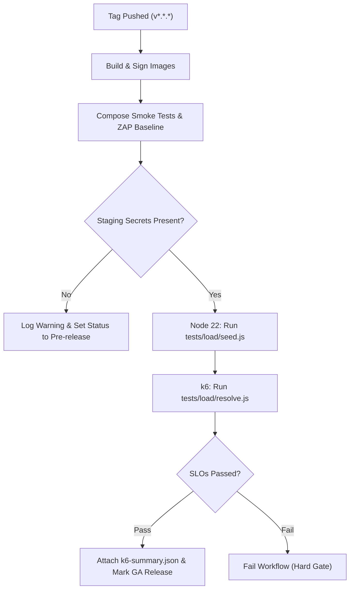

# Staging Load-Test Setup & Release Gate

**What this is:** Operational runbook for configuring the automated load-test gate in `.github/workflows/release.yml` (spec §D.5, §D.7 criterion 2).  
**Who it is for:** Site Reliability Engineers (SRE), Release Managers, and DevOps engineers maintaining the Deep Link Engine (DLE) deployment.

---

## 1. Context and Purpose

On every `v*` tag push, the release pipeline builds multi-architecture container images, runs static analysis, executes the full test suites, produces CycloneDX SBOMs and CBOMs, and executes acceptance gates.

One of the strict release gates is the **k6 resolve profile** (§D.5):
- Evaluates **1 000+ req/s** sustained throughput against a distributed link corpus.
- Asserts strict Service Level Objectives (SLOs):
  - **Latency:** \(p_{95} < 25\text{ ms}\), \(p_{99} < 50\text{ ms}\)
  - **Reliability:** Failure rate \(< 0.1\%\)
  - **Cache efficiency:** Edge HybridCache hit rate \(\ge 95\%\)
  - **Data integrity:** Metric `dle_click_events_dropped_total` \(= 0\)

Because the test corpus requires a pre-existing verified domain and persistent database, the load test executes against a persistent staging environment.

> [!IMPORTANT]
> If the required staging secrets are not configured in the GitHub repository, the workflow logs a warning and marks the GitHub Release as **`pre-release`**. A full **General Availability (GA)** release requires verified §D.5 evidence.

---

## 2. Required GitHub Repository Secrets

Configure the following four repository secrets under **Settings → Secrets and variables → Actions**:

| Secret Name | Description | Example Value |
|---|---|---|
| `DLE_LOADTEST_CONTROL_URL` | Public base URL of the staging control plane | `https://control.staging.example.com` |
| `DLE_LOADTEST_API_KEY` | Operator or tenant owner API key with write access | `dle_live_0123456789abcdef...` |
| `DLE_LOADTEST_DOMAIN_ID` | GUID of the verified staging link domain | `b4a2e8c1-5d9f-4318-b2a1-e49c71a36109` |
| `DLE_LOADTEST_LINK_HOST` | Hostname served by the staging edge resolvers | `links.staging.example.com` |

### Setting Secrets via GitHub CLI (`gh`)

```bash
gh secret set DLE_LOADTEST_CONTROL_URL --body "https://control.staging.example.com"
gh secret set DLE_LOADTEST_API_KEY --body "dle_live_staging_api_key_here"
gh secret set DLE_LOADTEST_DOMAIN_ID --body "b4a2e8c1-5d9f-4318-b2a1-e49c71a36109"
gh secret set DLE_LOADTEST_LINK_HOST --body "links.staging.example.com"
```

---

## 3. Staging Infrastructure Prerequisites

The staging environment should reflect the production architecture described in `deploy/docker-compose.yml` or the Helm chart `deploy/helm/dle`:

1. **PostgreSQL 18** with migrations applied up to date.
2. **Valkey 8** configured as the L2 distributed cache and pub/sub bus.
3. **`dle-control`** with at least one active tenant and verified link domain.
4. **`dle-edge`** (minimum 2 replicas behind Caddy / ingress reverse proxy).
5. Valid TLS certificates covering `DLE_LOADTEST_LINK_HOST` and `DLE_LOADTEST_CONTROL_URL`.

---

## 4. Execution Workflow

When all four secrets are present, `.github/workflows/release.yml` performs the following automated steps:



### Manual Run for Pre-release Verification

To manually execute the load test locally or from a staging bastion host:

```bash
# 1. Seed the test corpus (10 000 links, 100 hot links)
node tests/load/seed.js \
  --control "https://control.staging.example.com" \
  --api-key "dle_live_staging_key" \
  --domain-id "b4a2e8c1-5d9f-4318-b2a1-e49c71a36109" \
  --host "links.staging.example.com" \
  --total 10000 \
  --hot 100

# 2. Run k6 resolve benchmark
k6 run -e BASE_URL="https://links.staging.example.com" \
  --summary-export k6-summary.json \
  tests/load/resolve.js
```

---

## 5. Verification Checklist

- [ ] `k6-summary.json` generated and retained.
- [ ] No HTTP 5xx responses or dropped click events.
- [ ] Edge memory and CPU usage returned to baseline after test completion.
