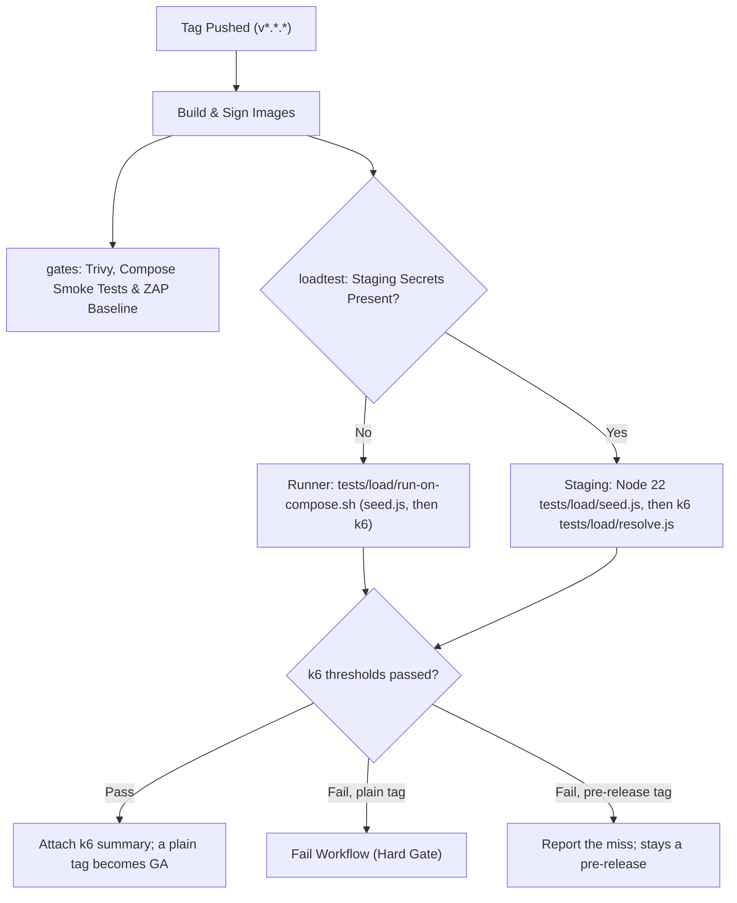

# Staging Load-Test Setup & Release Gate

**What this is:** Operational runbook for configuring the automated load-test gate in `.github/workflows/release.yml` (spec §D.5, §D.7 criterion 2).  
**Who it is for:** Site Reliability Engineers (SRE), Release Managers, and DevOps engineers maintaining the Deep Link Engine (DLE) deployment.

---

## 1. Context and Purpose

On every `v*` tag push, the release pipeline builds multi-architecture container images, runs static analysis, executes the full test suites, produces CycloneDX SBOMs and CBOMs, and executes acceptance gates.

One of the strict release gates is the **k6 resolve profile** (§D.5):
- Evaluates **1 000+ req/s** sustained throughput against a distributed link corpus.
- Asserted by k6 (thresholds in `tests/load/resolve.js`):
  - **Latency:** \(p_{95} < 25\text{ ms}\), \(p_{99} < 50\text{ ms}\) (steady scenario and hot links); \(p_{99} < 200\text{ ms}\) during the spike
  - **Reliability:** Failure rate \(< 0.1\%\); correct outcome \(> 99.9\%\)
- Not asserted by k6. On the runner path `tests/load/run-on-compose.sh` reads them from the edge's `/metrics` after the run and the release notes carry them; against staging, read them by hand:
  - **Cache efficiency:** Edge hit rate \(\ge 95\%\) over lookups of links that exist
  - **Data integrity:** Metric `dle_click_events_dropped_total` \(= 0\)

By default the gate needs no staging: the release's `loadtest` job, in parallel with the smoke and ZAP gates, starts the compose stack from the released images with `tests/load/compose.loadtest.yml` (resolve limiter off, 404 budget lifted, the machine's CPUs), and `tests/load/run-on-compose.sh` registers `link.dle.test` with the stack's throw-away bootstrap owner key — a domain is active on registration while `Dle:Control:RequireDomainOwnershipVerification` is off, its default — seeds it and runs k6 straight against the edge. The `Load test` workflow does the same before a tag, from images built on the commit. A persistent staging instance takes its place when the four secrets below are set.

A standard GitHub runner (4 vCPU) holds the steady scenario with room to spare (p95 4.5 ms against 25 ms) but cannot generate the 12 000 req/s spike next to the stack: k6 drops iterations and the spike tail misses 200 ms. A GA tag therefore needs a larger machine for the release's `loadtest` job, the only job that runs there. Set the repository variable `DLE_LOADTEST_RUNNER` to the `runs-on` label of a larger GitHub-hosted runner (GitHub Team or Enterprise) or of a dedicated self-hosted runner (Linux x64 with Docker, curl and jq, at least 16 vCPU, `link.dle.test` pointing at 127.0.0.1 in `/etc/hosts`; require approval for fork pull request workflows from outside collaborators). Try it first with the `Load test` workflow run by hand, whose `runner` input defaults to the same variable. Delete the variable before the machine goes away: a set variable sends every later tag's `loadtest` job to that label, and with no runner left the job never starts and nothing is released.

> [!IMPORTANT]
> The k6 thresholds decide either way. A plain tag whose run misses them fails the release; a pre-release tag reports the miss and stays a **`pre-release`**. Only a plain tag whose run passed becomes a full **General Availability (GA)** release and moves `:MAJOR.MINOR` and `:latest`.

---

## 2. Optional GitHub Repository Secrets (staging target)

To run the gate against staging instead of the release runner, configure all four repository secrets under **Settings → Secrets and variables → Actions**:

| Secret Name | Description | Example Value |
|---|---|---|
| `DLE_LOADTEST_CONTROL_URL` | Public base URL of the staging control plane | `https://control.staging.example.com` |
| `DLE_LOADTEST_API_KEY` | Operator or tenant owner API key with write access | `dle_k7QpX2mA_…` (format `dle_<prefix>_<secret>`) |
| `DLE_LOADTEST_DOMAIN_ID` | GUID of the verified staging link domain | `b4a2e8c1-5d9f-4318-b2a1-e49c71a36109` |
| `DLE_LOADTEST_LINK_HOST` | Hostname served by the staging edge resolvers | `links.staging.example.com` |

### Setting Secrets via GitHub CLI (`gh`)

```bash
gh secret set DLE_LOADTEST_CONTROL_URL --body "https://control.staging.example.com"
gh secret set DLE_LOADTEST_API_KEY --body "dle_<prefix>_<secret>"
gh secret set DLE_LOADTEST_DOMAIN_ID --body "b4a2e8c1-5d9f-4318-b2a1-e49c71a36109"
gh secret set DLE_LOADTEST_LINK_HOST --body "links.staging.example.com"
```

---

## 3. Staging Infrastructure Prerequisites

The staging environment should reflect the production architecture described in `deploy/docker-compose.yml` or the Helm chart `deploy/helm/dle`:

1. **PostgreSQL 18** with migrations applied up to date.
2. **Valkey 8** configured as the L2 distributed cache and pub/sub bus.
3. **`dle-control`** with at least one active tenant and verified link domain.
4. **`dle-edge`** (minimum 2 replicas behind Caddy / ingress reverse proxy).
5. Valid TLS certificates covering `DLE_LOADTEST_LINK_HOST` and `DLE_LOADTEST_CONTROL_URL`.

---

## 4. Execution Workflow

`.github/workflows/release.yml` performs the following automated steps:



### Manual Run for Pre-release Verification

To manually execute the load test locally or from a staging bastion host:

```bash
# 1. Seed the test corpus (10 000 links, 100 hot links)
node tests/load/seed.js \
  --control "https://control.staging.example.com" \
  --api-key "dle_<prefix>_<secret>" \
  --domain-id "b4a2e8c1-5d9f-4318-b2a1-e49c71a36109" \
  --host "links.staging.example.com" \
  --total 10000 \
  --hot 100

# 2. Run k6 resolve benchmark
k6 run -e BASE_URL="https://links.staging.example.com" \
  --summary-export k6-summary.json \
  tests/load/resolve.js
```

---

## 5. Verification Checklist

- [ ] `k6-summary.json` generated and retained.
- [ ] No HTTP 5xx responses.
- [ ] Cache hit rate ≥ 95 % and no dropped click events, read from the OTLP metrics (k6 does not check these).
- [ ] Edge memory and CPU usage returned to baseline after test completion.
