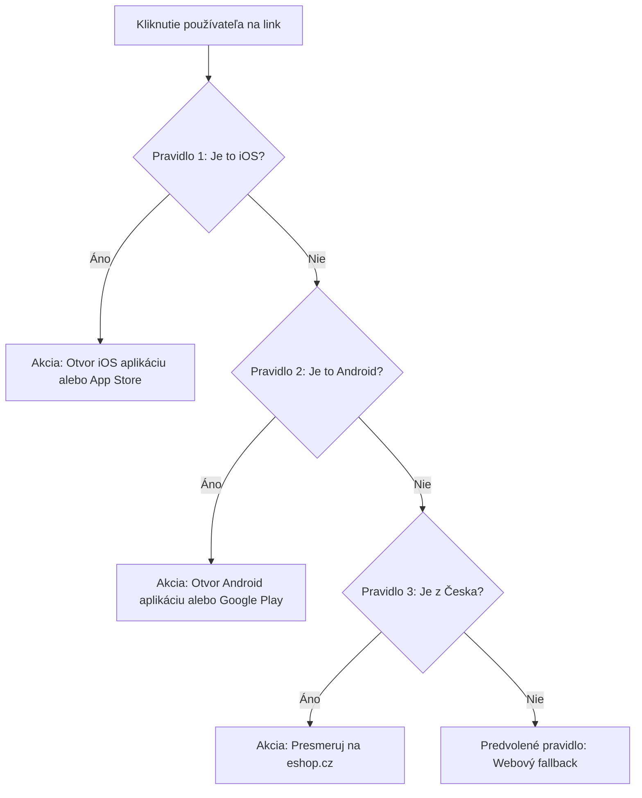

# Používateľská príručka — Administračná konzola (Admin Console)

**Čo je tento dokument:** Kompletný sprievodca webovou administračnou konzolou Deep Links Engine (DLE) pre tvorcov odkazov, marketingových špecialistov, kampaňových manažérov a administrátorov.
**Komu je určený:** Každému, kto vytvára alebo spravuje krátke a inteligentné deep linky, vyhodnocuje atribučné kampane, nastavuje smerovanie na mobilné aplikácie a konfiguruje domény či aplikácie tenanta ([§A.2](../zadanie.md#a2-smerovacia-matrica-a-podporované-platformy), [§B.1](../zadanie.md#b1-dátový-model-odkazu), [§B.2](../zadanie.md#b2-routing-rules-dsl)).

---

## Obsah

1. [Úvod a prvé prihlásenie](#1-úvod-a-prvé-prihlásenie)
2. [Nastavenia pripojenia, tenanta a jazyka](#2-nastavenia-pripojenia-tenanta-a-jazyka)
3. [Prehľad a analytika (Dashboard)](#3-prehľad-a-analytika-dashboard)
4. [Správa odkazov (Linky)](#4-správa-odkazov-linky)
5. [Tvorba a úprava odkazu (Link Editor)](#5-tvorba-a-úprava-odkazu-link-editor)
6. [Pravidlá smerovania (Routing Rules DSL)](#6-pravidlá-smerovania-routing-rules-dsl)
7. [Simulátor smerovania (Simulator)](#7-simulátor-smerovania-simulator)
8. [Správa domén (Domains)](#8-správa-domén-domains)
9. [Správa mobilných aplikácií a SDK kľúčov (Apps)](#9-správa-mobilných-aplikácií-a-sdk-kľúčov-apps)
10. [Integrácie a Webhooky](#10-integrácie-a-webhooky)
11. [Nahlasovanie zneužitia a karanténa (Abuse)](#11-nahlasovanie-zneužitia-a-karanténa-abuse)
12. [Riešenie častých problémov (FAQ & Troubleshooting)](#12-riešenie-častých-problémov-faq--troubleshooting)

---

## 1. Úvod a prvé prihlásenie

Administračná konzola DLE je moderná webová aplikácia (Single Page Application), ktorá beží priamo vo vašom prehliadači a komunikuje cez zabezpečené rozhranie (REST API) s riadiacou službou (*control plane*).

### Možnosti prihlásenia

Do konzoly sa môžete prihlásiť dvoma spôsobmi podľa toho, ako vašu inštanciu nastavil prevádzkovateľ:

1. **Osobné prihlásenie cez firemné SSO (OIDC / OAuth 2.0):**
   - V sekcii **Nastavenia** kliknite na tlačidlo **Prihlásiť sa cez SSO (OIDC)**.
   - Budete presmerovaní na váš firemný identity provider (Google Workspace, Microsoft Entra ID, Keycloak, Okta a pod.).
   - Po overení vás systém automaticky vráti do konzoly s priradenou rolou a tenantom.

2. **Prihlásenie pomocou API kľúča:**
   - Zadajte adresu control plane (napr. `http://localhost:8081` alebo produkčnú URL ako `https://control.example.com`). Ak konzolu servíruje samotná služba control plane, pole nechajte prázdne.
   - Do poľa **API kľúč** vložte svoj vygenerovaný token (začínajúci prefixom `dle_live_...`).
   - Kľúč sa odosiela v každej požiadavke ako `Bearer` token. Na serveri je bezpečne uložený iba jeho jednosmerný Argon2id odtlačok.

> [!TIP]
> **Zapamätať na tomto zariadení:**
> - Ak je voľba **vypnutá**, kľúč sa uchováva iba v pamäti aktuálnej záložky prehliadača (ideálne na zdieľaných počítačoch).
> - Ak je voľba **zapnutá**, kľúč sa uloží do chráneného lokálneho úložiska prehliadača (`localStorage`) pre váš profil.

### Používateľské roly a oprávnenia

Prístup k jednotlivým funkciám závisí od vašej priradenej roly:

| Rola v systéme | Názov v UI | Oprávnenia | Typický používateľ |
|---|---|---|---|
| `owner` | **Vlastník** | Úplný prístup ku všetkému: správa tenanta, vytváranie a zneplatňovanie API kľúčov, mazanie dát. | Prevádzkovateľ, Tech Lead |
| `admin` | **Administrátor** | Správa aplikácií, domén, webhookov, linkov a pravidiel smerovania. | Systémový administrátor, Marketing Lead |
| `editor` | **Editor** | Tvorba, úprava a archivácia linkov, nastavenie UTM a Open Graph, testovanie v simulátore. | Kampaňový manažér, Copywriter, PPC špecialista |
| `viewer` | **Čitateľ** | Náhľad štatistík na dashboarde, zoznamu odkazov a ich konfigurácie bez možnosti úprav. | Analytik, Stakeholder, Audit |

---

## 2. Nastavenia pripojenia, tenanta a jazyka

V pravom hornom rohu alebo cez bočné menu **Nastavenia** (*Settings*) môžete spravovať profil a prostredie:

- **Jazyk rozhrania:** Prepínanie medzi **Slovenčinou** a **English**. Celé rozhranie, chybové hlásenia aj validačné popisy sú kompletne lokalizované.
- **Vzhľad rozhrania:** Voľba medzi témami **Svetlý**, **Tmavý** alebo **Podľa systému** (automatické prispôsobenie OS).
- **Režim súhlasu tenanta (Consent Mode):**
  - `off` — bez ukladania údajov o jednotlivých kliknutiach.
  - `aggregate_only` — ukladá agregované štatistiky; **nevyžaduje súhlasovú lištu** na webe/v aplikácii (v súlade s ePrivacy a GDPR pre oprávnený záujem).
  - `full` — povolí presné probabilistické párovanie atribúcie. Vyžaduje predchádzajúci súhlas používateľa podľa GDPR.
- **Správa API kľúčov:**
  - Vytvorenie nového kľúča pre člena tímu alebo automatizovaný skript.
  - Pri vytváraní vyberte rolu a **odporúčame vždy nastaviť dátum expirácie**.
  - Vygenerovaný kľúč sa v plnom znení zobrazí **iba raz**. Okamžite si ho skopírujte a uložte do bezpečného správcu hesiel.

---

## 3. Prehľad a analytika (Dashboard)

Dashboard slúži na rýchle vyhodnotenie výkonnosti vašich kampaní, sledovanie kliknutí, inštalácií a overenie férovosti atribúcie.

### Filtre a časové obdobie
V hornej časti môžete zvoliť:
- **Obdobie:** Posledných 7 dní, 30 dní alebo 90 dní.
- **Granularitu:** Rozpad po hodinách, dňoch, týždňoch alebo mesiacoch.
- **Zahrnúť botov:** Štandardne sú roboty (web crawleri sociálnych sietí ako Meta, Slackbot, Googlebot) odfiltrovaní. Zaškrtnutím prepínača zobrazíte aj ich aktivitu (užitočné pri overovaní indexácie).

### Hlavné ukazovatele (KPI)
- **Kliknutia (Clicks):** Celkový počet zaznamenaných prechodov cez vaše odkazy.
- **Inštalácie (Installs):** Počet prvých otvorení mobilnej aplikácie nahlásených cez DLE mobilné SDK.
- **Atribuované (Attributed):** Inštalácie, ktoré systém úspešne priradil ku konkrétnemu odkazu a kampaňovému kliknutiu.
- **Konverzie (Conversions):** Počet nadväzujúcich cieľových akcií (napr. nákup, registrácia), ak ich aplikácia odosiela.
- **Miera konverzie (Conversion Rate):** Pomer konverzií voči kliknutiam.

### Rozpad prevádzky (Breakdowns)
- **Podľa krajiny:** Zobrazenie návštevnosti na základe GeoIP lokality (napr. SK, CZ, AT, DE).
- **Podľa platformy:** Pomer medzi iOS, Androidom a Desktopom.
- **Podľa kanála:** Rozlíšenie bežného prehliadača od in-app webview prehliadačov sociálnych sietí (Instagram, Facebook, TikTok, LinkedIn, WhatsApp a pod.).

### Kvalita atribúcie (Attribution Quality)

DLE striktne oddeľuje overené spárovania od odhadov ([§C.1](../zadanie.md#c1-architektúra-atribúcie)):

```
┌────────────────────────────────────────────────────────────────────────┐
│                        KVALITA ATRIBÚCIE                              │
├────────────────────────┬────────────────────────┬──────────────────────┤
│     Deterministické    │     Probabilistické    │      Nespárované     │
│   (Confidence = 1.0)   │ (Confidence 0.3 - 0.9) │     (Neistý pôvod)   │
└────────────────────────┴────────────────────────┴──────────────────────┘
```

1. **Deterministické (Confidence 1,00):**
   - **Install Referrer:** Presný prenos tokenu cez Google Play Install Referrer API.
   - **Claim kód:** Jednorazový bezpečný kód vyzdvihnutý mobilnou aplikáciou na iOS (Direct Open / Claim API).
   - **Prihlásenie:** Spárovanie prihláseného profilu.
   - **Priame otvorenie:** Otvorenie aplikácie priamo cez Universal Link / App Link bez medzičlánku.
2. **Probabilistické (Confidence 0,30–0,90):**
   - Využíva hrubé signály (časové okno kliknutia, anonymizovaný IP prefix, verziu OS). Funguje výhradne v režime `full` so súhlasom používateľa.
3. **Nespárované:**
   - Inštalácie z organických zdrojov alebo také, kde uplynulo časové okno pre spárovanie.

---

## 4. Správa odkazov (Linky)

Prehľad všetkých vašich vytvorených odkazov nájdete v sekcii **Linky** (*Links*).

### Možnosti práce so zoznamom
- **Vyhľadávanie:** Rýchle filtrovanie podľa slugu, názvu odkazu alebo cieľovej URL.
- **Filtrovanie:** Podľa priradených štítkov (**Tag**), domény a možnosti zobraziť archivované linky.
- **Stavy odkazu:**
  - `Aktívny` — link riadne smeruje návštevníkov.
  - `Neaktívny` — link je dočasne vypnutý manuálne.
  - `Naplánovaný` — začne fungovať až v zadanom budúcom čase (`starts_at`).
  - `Expirovaný` — platnosť linku vypršala (`expires_at`), požiadavky smerujú na náhradnú URL alebo vracajú 404.
  - `V karanténe` — zablokovaný bezpečnostným tímom po nahlásení phishingu či spamu (odpovedá HTTP 410 Gone).

### Rýchle akcie
Pri každom odkaze v tabuľke môžete kliknúť na:
- **Kopírovať krátku URL:** Uloží hotový link (napr. `https://link.example.sk/promo`) do schránky.
- **QR:** Otvorí okno s vygenerovaným vektorovým QR kódom pripraveným na stiahnutie alebo vloženie do tlačových materiálov.
- **Rýchla úprava:** Umožňuje pohotovo upraviť cieľovú URL bez nutnosti otvárať plný editor.
- **Archivovať / Zmazať:** Zneplatnenie alebo trvalé odstránenie odkazu.

---

## 5. Tvorba a úprava odkazu (Link Editor)

Kliknutím na **Nový link** (*Create link*) sa otvorí plnohodnotný editor odkazu:

### 1. Základné parametre
- **Doména:** Výber z vašich overených a aktívnych domén.
- **Slug (koncová časť URL):**
  - *Nechajte prázdne:* Systém vygeneruje bezpečný náhodný 8-znakový reťazec (napr. `xK9pLm2Q`).
  - *Vlastný slug:* Môžete zadať vlastný čitateľný názov (napr. `letny-vypredaj`). Musí mať **3–7 znakov** alebo **9 a viac znakov** (rozsah 8 znakov je vyhradený pre náhodné ID, aby sa predišlo kolíziám).
- **Názov a Popis:** Interné označenie odkazu pre vašu orientáciu a tímovú spoluprácu.

### 2. Cieľ a deep link
- **Webová cieľová URL:** Hlavná adresa (napr. `https://eshop.sk/letny-vypredaj`), kam návštevník dorazí, ak nemá nainštalovanú aplikáciu alebo pristupuje z bežného počítača.
- **Cesta deep linku:** Relatívna cesta vo vnútri vašej mobilnej aplikácie (napr. `/products/summer-sale` alebo `/campaign?code=SUMMER`).
  > [!IMPORTANT]
  > Cesta deep linku **nikdy nesmie byť celá URL** so schémou `http://` ani `myapp://`. Zadávajte iba relatívnu cestu začínajúcu lomkou `/`.

### 3. Rýchle generovanie fallbackov pre platformy
Pre bežné mobilné kampane nemusíte ručne písať zložité pravidlá. V sekcii **Fallbacky podľa platformy** stačí vyplniť:
- **URL App Store:** Odkaz na vašu aplikáciu v Apple App Store.
- **URL Google Play:** Odkaz na vašu aplikáciu v obchode Google Play.
- Kliknite na **Vygenerovať pravidlá pre platformy**. Systém automaticky vytvorí optimálne smerovacie pravidlá pre iOS a Android.

### 4. Open Graph náhľady (Sociálne metadáta)
Keď niekto pošle váš odkaz cez WhatsApp, Slack, Messenger alebo ho zazdieľa na Facebooku či LinkedIn, sociálna sieť stiahne metadáta:
- `og:title` — Zvodný titulok karty.
- `og:description` — Pútavý popis pod titulkom.
- `og:image` — Absolútna adresa pútavého obrázka (odporúčané rozlíšenie 1200 × 630 px).
- `twitter:card` — Typ zobrazenia na sociálnej sieti X (napr. `summary_large_image`).
- **Živý náhľad v editore:** Priamo v pravej časti obrazovky okamžite vidíte, ako bude karta vyzerať po odoslaní v chatovacích aplikáciách.

### 5. UTM parametre
Slúžia na presné meranie zdrojov v Google Analytics 4 alebo iných nástrojoch:
- `utm_source` (napr. `newsletter`, `facebook`, `instagram`)
- `utm_medium` (napr. `cpc`, `stories`, `email`)
- `utm_campaign` (napr. `black_friday_2026`)
- `utm_term`, `utm_content`
- Editor zobrazuje náhľad výslednej adresy vrátane všetkých pripojených parametrov. Tieto parametre systém automaticky odovzdá aj do mobilného SDK pri inštalácii.

### 6. Časová platnosť a expirácia
- **Začína (`starts_at`):** Link bude pred týmto dátumom neaktívny.
- **Expiruje (`expires_at`):** Po tomto dátume link automaticky prestane smerovať na kampaň.
- **URL po expirácii (`expired_url`):** Namiesto chybovej stránky 404 môžete expirovaný link presmerovať na domovskú stránku alebo na oznámenie o ukončení akcie.

---

## 6. Pravidlá smerovania (Routing Rules DSL)

Jadrom Deep Links Engine je deterministický pravidlový systém ([§B.2](../zadanie.md#b2-routing-rules-dsl)).

### Základné princípy vyhodnocovania
1. **Pravidlá sa vyhodnocujú zhora nadol v presnom poradí.**
2. **Vyhráva prvá zhoda (First match wins):** Akonáhle návštevník vyhovuje podmienkam pravidla, uplatní sa jeho akcia a ďalšie pravidlá sa ignorujú.
3. **Predvolené pravidlo (Default Rule) je povinné a musí byť VŽDY posledné:** Nemá žiadnu podmienku `when` a zachytáva všetkých návštevníkov, ktorí nesplnili predchádzajúce podmienky. Bez neho systém odkaz odmietne uložiť.



### Možné podmienky (`when`)
- **Platforma (`platform`):** `ios`, `android`, `desktop`, `other`.
- **Krajina (`country`):** ISO 3166-1 alpha-2 kódy oddelené čiarkou (napr. `SK, CZ`).
- **Jazyk (`language`):** Jazyk prehliadača používateľa (napr. `sk, cs, en`).
- **Kanál (`channel`):** Štandardný prehliadač vs. in-app webview konkrétnej siete (Facebook, Instagram, TikTok, LinkedIn, Pinterest...).
- **Verzia OS a Verzia aplikácie:** Podpora operátorov rovná sa (`eq`), väčšia než (`gt`), aspoň (`gte`), menšia než (`lt`), najviac (`lte`).
- **Časové okno (Time window):** Časový interval platnosti pravidla v UTC.
- **Dni v týždni a hodiny:** Cielenie kampane iba v určitých dňoch (napr. počas víkendu) alebo hodinách (0–23 UTC).
- **A/B rozdelenie (`ab`):** Rozdelenie prevádzky do variantov (napr. Variant A = 50 %, Variant B = 50 %) na základe deterministického hashu `click_id`.

### Možné akcie (`then`)
- **Presmerovanie na web (`web`):** Presmeruje návštevníka na zadanú webovú stránku (HTTP 302).
- **Aplikácia, inak obchod (`app_or_store`):** Primárne otvorí natívnu aplikáciu (cez Universal Link / App Link). Ak aplikácia nie je nainštalovaná, presmeruje používateľa do App Store alebo Google Play.
- **Len obchod (`store_only`):** Priame otvorenie obchodu s aplikáciami.
- **Len aplikácia (`app_only`):** Otvorenie aplikácie bez náhradného riešenia.
- **Blokovať (`block`):** Zablokovanie prístupu (napr. pre vybrané škodlivé krajiny alebo nepovolené kanály).

### Interstitial stránka (Medzistránka)
V in-app prehliadačoch (Instagram, TikTok) často platforma blokuje priame otvorenie externej aplikácie:
- **Auto (odporúčané):** Zobrazí čistú, bleskovú medzistránku s tlačidlom „Otvoriť v aplikácii“ iba pre problematické in-app webview prehliadače.
- **Vždy (Always):** Vždy zobrazí medzistránku.
- **Nikdy (Never):** Pokúsi sa o okamžité presmerovanie bez zobrazenia stránky.

---

## 7. Simulátor smerovania (Simulator)

Pred spustením drahej marketingovej kampane si môžete overiť správanie pravidiel v **Simulátore**.

### Výhody simulátora
- **Nulový dopad na analytiku:** Simulácia nezapočítava falošné kliknutia do štatistík ani do atribúcie.
- **Presnosť 1:1:** Simulátor volá rovnaký vyhodnocovací engine na riadiacej vrstve, aký beží na produkčnej edge sieti.

### Ako simulovať
1. Otvorte záložku **Simulátor** a vyberte link, ktorý chcete otestovať.
2. Môžete kliknúť na pripravené predvoľby (*Presets*):
   - *iPhone · iOS 18 · SK · Instagram*
   - *Android 15 · CZ · prehliadač*
   - *Desktop · DE · prehliadač*
3. Alebo ručne zadajte ľubovoľnú kombináciu parametrov (User-Agent, krajinu, čas, platformu).
4. Kliknite na **Spustiť simuláciu**.
5. V sekcii **Výsledok** ihneď uvidíte:
   - Ktoré konkrétne pravidlo zvíťazilo (**Zodpovedajúce pravidlo**).
   - Aké rozhodnutie engine prijal (**Rozhodnutie** — napr. *Presmerovanie do App Store*, *Priame otvorenie aplikácie*, *Presmerovanie na web*).
   - Výslednú cieľovú URL a cestu deep linku.
   - Kompletnú podrobnú stopu vyhodnocovania (**Trace**), vďaka čomu presne vidíte, prečo predchádzajúce pravidlá neboli uplatnené.

---

## 8. Správa domén (Domains)

Sekcia **Domény** slúži na registráciu a správu internetových adries, z ktorých vaše odkazy smerujú (napr. `go.mojafirma.sk` alebo `link.eshop.sk`).

### Pridanie domény
1. Kliknite na **Pridať doménu**.
2. Zadajte **Host** (napr. `link.example.com`).
3. Zvoľte predvolený jazyk pre prípadné medzistránky (interstitials).
4. Určite, či má byť táto doména predvolená pre nové odkazy.

### Overenie stavu domény
Pri každej doméne vidíte aktuálny stav:
- **TLS certifikát:** Overenie zabezpečenia HTTPS.
- **AASA:** Stav generovania súboru `/.well-known/apple-app-site-association` pre Apple Universal Links.
- **assetlinks:** Stav generovania súboru `/.well-known/assetlinks.json` pre Android App Links.
- Kliknutím na **Overiť teraz** systém vykoná okamžitú diagnostiku konektivity, presmerovaní a formátu asociačných súborov.

> [!WARNING]
> **Doba propagácie zmien na zariadeniach (až 7 dní):**
> Spoločnosť Apple sťahuje asociačné súbory cez vlastnú CDN (obnovuje sa približne raz za 24 hodín) a samotné iPhony si zoznam obnovujú zhruba raz týždenne. Podobne Android 15+ vykonáva periodické overovanie. Zmena konfigurácie domény alebo pridanie novej aplikácie sa preto u všetkých koncových používateľov na zariadeniach môže prejaviť **až v priebehu 7 dní**. Ide o správanie mobilných operačných systémov, ktoré nemožno zo strany servera urýchliť.

---

## 9. Správa mobilných aplikácií a SDK kľúčov (Apps)

Aby vaše odkazy dokázali priamo otvoriť nainštalovanú mobilnú aplikáciu, musíte ju zaregistrovať v sekcii **Aplikácie**.

### Registrácia iOS aplikácie
- **Platforma:** iOS
- **Bundle ID:** Identifikátor aplikácie (napr. `sk.mojafirma.app`).
- **Apple Team ID:** 10-znakový alfanumerický kód z vášho Apple Developer účtu (napr. `AB12CD34EF`). Tento údaj je pre fungovanie Universal Links **povinný**.
- **URL v App Store:** Odkaz na stiahnutie aplikácie.
- **Priradené domény:** Vyberte domény, na ktorých má byť táto aplikácia publikovaná v asociačnom súbore AASA.

### Registrácia Android aplikácie
- **Platforma:** Android
- **Názov balíka (Package Name):** Identifikátor balíka (napr. `sk.mojafirma.android`).
- **SHA-256 odtlačky podpisového certifikátu:** Odtlačok v hexadecimálnom tvare oddelený dvojbodkami.
- **URL v Google Play:** Odkaz na stiahnutie aplikácie.

> [!CAUTION]
> **Android Play App Signing vs. Lokálny Keystore:**
> Ak používate službu **Google Play App Signing** (štandard v Google Play), aplikáciu koncovým používateľom podpisuje samotný Google. SHA-256 odtlačok musíte získať priamo z **Google Play Console → Release → Setup → App signing → „App signing key certificate“**.
> Ak zadáte odtlačok svojho lokálneho vývojárskeho kľúča (upload keystore), aplikácia bude fungovať iba vo vývojárskych verziách, no v produkcii u zákazníkov deep linking potichu zlyhá!

### SDK Kľúče (SDK Keys)
Pre komunikáciu mobilných aplikácií s DLE (odosielanie informácií o otvorení a inštalácii) slúžia SDK kľúče:
- SDK kľúč je určený na vloženie do kódu mobilnej aplikácie.
- Má striktne obmedzené oprávnenia: dokáže **iba odosielať atribučné udalosti**, nikdy nemôže meniť konfiguráciu odkazov ani tenanta.
- V prípade podozrenia na zneužitie je možné kľúč kedykoľvek v konzole zneplatniť jedným kliknutím.

---

## 10. Integrácie a Webhooky

Ak potrebujete posielať informácie o klikoch a úspešných inštaláciách v reálnom čase do vášho interného CRM, BI nástroja alebo e-commerce platformy, využite **Webhooky**.

### Nastavenie webhooku
1. V sekcii **Webhooky** kliknite na **Pridať webhook**.
2. Zadajte **Cieľovú URL** (povolené je výhradne zabezpečené HTTPS; privátne lokálne IP adresy systém z bezpečnostných dôvodov odmietne).
3. Vyberte požadované udalosti:
   - `attribution.created` — úspešne spárovaná inštalácia s kampaňovým klikom.
   - `link.created`, `link.updated`, `link.quarantined` — zmeny v konfigurácii odkazov.
4. Po vytvorení si skopírujte **podpisové tajomstvo** (zobrazí sa iba raz). Každá požiadavka je podpísaná hlavičkou `DLE-Signature` (HMAC-SHA-256 a Ed25519 voči `/.well-known/jwks.json`), vďaka čomu si na svojom serveri overíte, že dáta naozaj pochádzajú z DLE.
5. Využite tlačidlo **Poslať test** na okamžité odoslanie testovacej správy a overenie reakcie vášho servera.

---

## 11. Nahlasovanie zneužitia a karanténa (Abuse)

V súlade s európskou legislatívou (Digital Services Act, čl. 16) obsahuje DLE plnohodnotný mechanizmus na ochranu pred škodlivým obsahom ([§E.5](../zadanie.md#e5-karanténa-a-triage-zneužitia)).

### Pohľady v sekcii Zneužitie
- **Nahlásenia mojich linkov:** Prehľad podnetov od používateľov týkajúcich sa vašich odkazov (napr. podozrenie na phishing, spam alebo autorské práva).
- **Triage fronta:** Pracovná fronta pre zodpovedných operátorov na posúdenie opodstatnenosti hlásenia.
- **Karanténa (Quarantine):**
  - Ak je odkaz vyhodnotený ako nebezpečný, systém ho neumaže, ale presunie do **karantény**.
  - **Prečo karanténa namiesto zmazania?** Úplné zmazanie by zničilo dôkazový a auditný záznam potrebný pre prípadné právne konanie.
  - Link v karanténe okamžite odpovedá chybovým kódom **HTTP 410 Gone** a nikto cez neho nemôže byť presmerovaný na škodlivý web.
  - Ak sa preukáže, že hlásenie bolo neoprávnené, administrátor môže link z karantény kedykoľvek uvoľniť s uvedením písomného dôvodu.

---

## 12. Riešenie častých problémov (FAQ & Troubleshooting)

### 1. Link sa na iPhone otvára v Safari namiesto mobilnej aplikácie
- **Najčastejšia príčina:** Používateľ vložil link do vyhľadávacieho riadku Safari alebo naň klikol na stránke bežiacej na rovnakej doméne. Apple Universal Links fungujú iba vtedy, ak používateľ klikne na odkaz z *odlišnej* domény alebo z externej aplikácie (napr. z Mailu, Poznámok alebo chatu).
- **Druhá príčina:** Od registrácie aplikácie alebo zmeny domény neuplynula doba potrebná na synchronizáciu Apple CDN (môže trvať až 24 hodín až 7 dní).
- **Riešenie:** Skontrolujte stav domény v sekcii **Domény** (musí svietiť `OK` pri AASA) a otestujte odkaz kliknutím z aplikácie Poznámky na reálnom iPhone.

### 2. V aplikáciách Instagram alebo TikTok nefunguje otvorenie aplikácie
- **Príčina:** Sociálne siete otvárajú odkazy vo svojom obmedzenom in-app prehliadači (webview), ktorý blokuje štandardné presmerovania na externé aplikácie, aby udržal používateľa vo svojej sieti.
- **Riešenie:** V pravidlách smerovania nastavte pri príslušnej akcii režim **Interstitial** na `Auto`. DLE zobrazí používateľovi prehľadnú medzistránku s tlačidlom, ktoré spoľahlivo vyskočí z webview priamo do natívnej aplikácie.

### 3. Editor hlási „Chýba predvolené pravidlo“ (Missing default rule)
- **Príčina:** V pravidlách smerovania nemáte vytvorené všeobecné pravidlo alebo predvolené pravidlo nie je zaradené ako posledné.
- **Riešenie:** Kliknite na tlačidlo **Pridať predvolené pravidlo** a pomocou šípok ho posuňte na úplný koniec zoznamu pravidiel.

### 4. Chyba „Tento slug je na doméne už obsadený“ (Slug is taken)
- **Príčina:** Zvolený slug už na danej doméne používa iný aktívny odkaz.
- **Riešenie:** Zvoľte iný názov slugu alebo vyberte inú doménu zo zoznamu.

### 5. API kľúč bol odmietnutý (401 Unauthorized / 403 Forbidden)
- **Príčina:** Vášmu kľúču vypršala platnosť (expirácia), bol zneplatnený administrátorom alebo nemá dostatočné oprávnenia pre požadovanú operáciu (napr. rola `viewer` sa pokúša vytvoriť odkaz).
- **Riešenie:** V **Nastaveniach** skontrolujte stav pripojenia, prípadne požiadajte vlastníka (`owner`) o vygenerovanie nového kľúča so zodpovedajúcou rolou.
